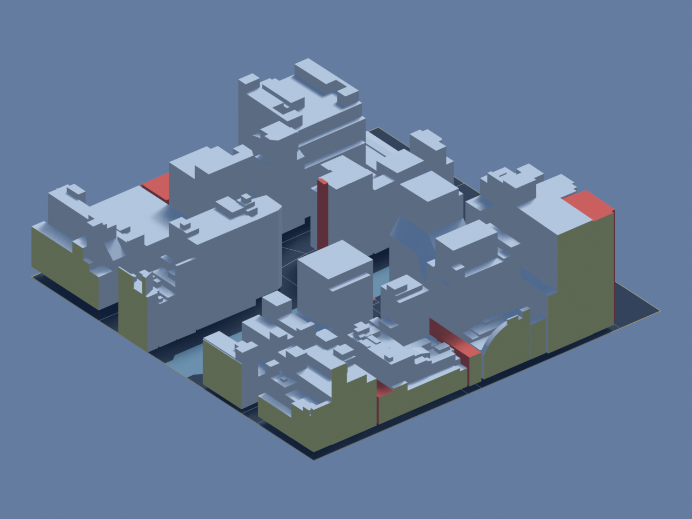
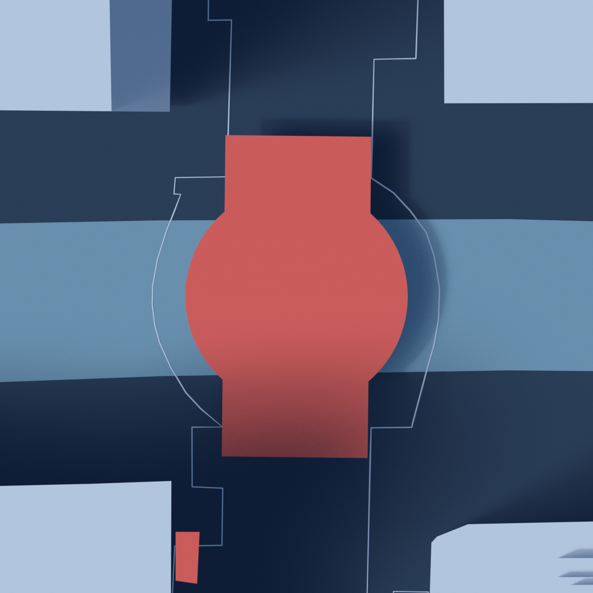
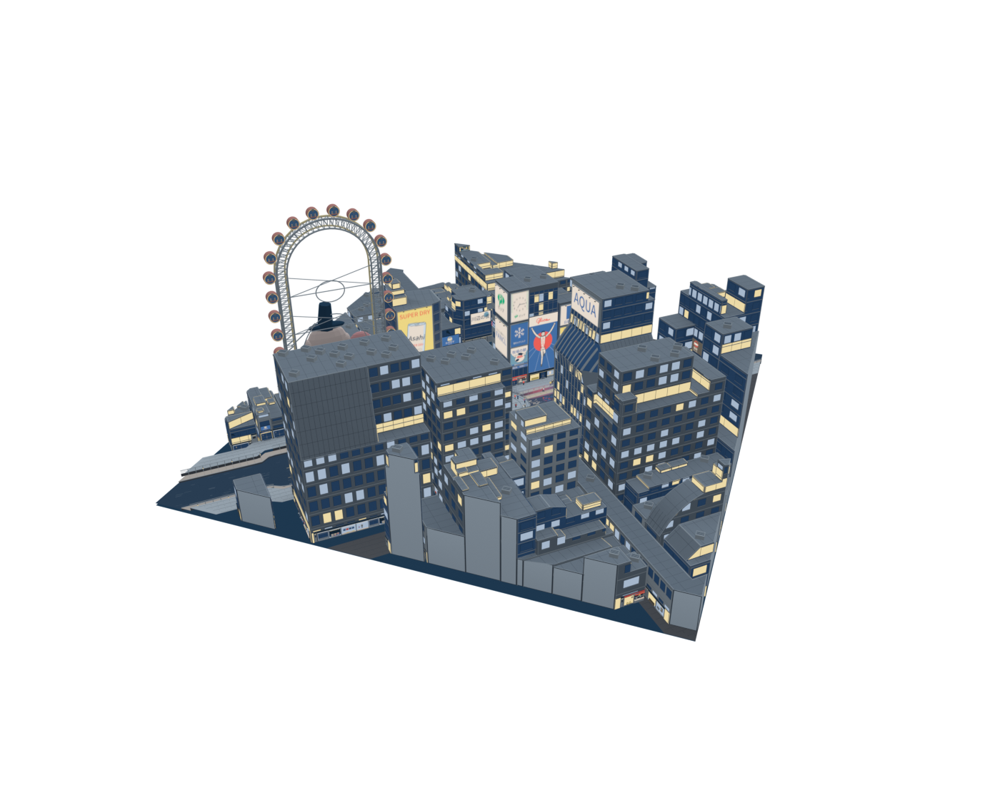

# Dōtonbori Blender study

Status: Active source study; runtime study integrated; detailed reconstruction incomplete<br>
Scope: Metric Ebisubashi / Dōtonbori reference assets<br>
Updated: 2026-09-20

[Design QR index](README.md) · [Reconstruction requirements](build-plan.md) ·
[Source ledger](sources.md)

The reviewed bridge GLB and a derived square crop power the [Dōtonbori City preset](overview.md).
The source master and its evidence limitations remain unchanged. Runtime-only
waterfront, landmark, and activity layers are described in the preset overview;
they are not stored in these source-study GLBs. A separate editable waterfront
review now snapshots those additions alongside the source context.

## Current result

The editable master contains 73 PLATEAU building solids, a separately clipped
160 m study, geographic plan guides and an incomplete bridge-deck envelope.
Sixty-six building features use actual LOD2 surfaces; seven retain LOD1.
Source roof shapes are imported from the solids rather than reconstructed
from floor counts. Façade details and advertising have not been invented.



The diagnostic colors distinguish source surfaces, lower-detail features
and authoring cuts. They are not measured building finishes. The dense
surrounding blocks obscure parts of the canal at this review angle; this
camera is not an approved product composition.

## Files and scene ownership

| Artifact | Contents |
| --- | --- |
| [Editable Blender master](../../../../assets/design-qr/dotonbori/dotonbori-source.blend) | Dedicated metric scene, full original solids, crop, guides, bridge study and review cameras |
| [Building study GLB](../../../../assets/design-qr/dotonbori/dotonbori-study.glb) | 73 clipped building objects; 4,796 triangles; four diagnostic material roles |
| [Focused Blender model](../../../../assets/design-qr/dotonbori/dotonbori-focus.blend) | Separate editable 58-building composition in metric coordinates, with an explicit Donki translation |
| [Focused building GLB](../../../../assets/design-qr/dotonbori/dotonbori-focus.glb) | Runtime composition; 3,732 triangles; source surfaces and outer-boundary gold caps |
| [Focus layout](../../../../assets/design-qr/dotonbori/focus-layout.json) | Bridge-centered 144 m square, 45° rotation, Donki translation, selected/omitted IDs and clipped plan overlays |
| [Focus manifest](../../../../assets/design-qr/dotonbori/focus-manifest.json) | Source/layout/export hashes, closed topology and retained-vertex checks |
| [Bridge deck study GLB](../../../../assets/design-qr/dotonbori/dotonbori-bridge-deck-study.glb) | Separate incomplete envelope; 860 triangles; no ramps, rails or finished pavement |
| [Compiled source solids](../../../../assets/design-qr/dotonbori/source-meshes.json) | 2,655 vertices, 5,018 triangles, 2,307 original polygons, surface roles, feature IDs and source hashes |
| [Extended source solids](../../../../assets/design-qr/dotonbori/east-source-meshes.json) | 132 candidates; 4,654 vertices, 8,780 triangles and 4,185 original polygons, from the same source GML |
| [East source audit](references/east-site-audit.json) | Extended coverage, stable audit IDs, GML provenance and Donki footprint registration |
| [Bridge dimensions and registration](../../../../assets/design-qr/dotonbori/bridge-deck-study.json) | Published values, map controls, fit residuals, explicit interpolation and unresolved conflicts |
| [Waterfront layout](../../../../assets/design-qr/dotonbori/waterfront-layout.json) | Runtime bank polygons, display levels, bridge profile, boat dimensions, and input hashes; generated after the focus layout |
| [Editable waterfront review](../../../../assets/design-qr/dotonbori/dotonbori-waterfront.blend) | Runtime geometry in metric ENU: complete source inventory including all 58 selected detailed buildings, central 1F storefronts, 64 pedestrians, the populated DOTON boat and original packed sign artwork |
| [Waterfront review meshes](../../../../assets/design-qr/dotonbori/waterfront-review-meshes.json) | Reproducible static snapshot with source-code hashes, vertex colors and UVs; independent from the runtime GLBs |
| [Waterfront review manifest](../../../../assets/design-qr/dotonbori/waterfront-review-manifest.json) | Snapshot, builder, Blender and original artwork hashes |
| [Study manifest](../../../../assets/design-qr/dotonbori/study-manifest.json) | File hashes/bytes, units, axes, source inventory, crop cleanup, roles and omissions |
| [Export validation](../../../../assets/design-qr/dotonbori/validation.json) | Independent GLB integrity checks; does not certify physical accuracy |
| [Blender validation](../../../../assets/design-qr/dotonbori/blender-validation.json) | Source-coordinate comparison, topology, camera framing and saved-master inventory |

The scene is `DesignQR Dotonbori Source Study`; its generated data carry
owner `designqr-dotonbori-study`. The builder replaces only that owned scene
and data. It preserves other scenes and refuses to replace an unowned scene
with the same name. Saving uses a separate Blender library file rather than
overwriting the user's open project.

Collections separate full source solids, the 160 m crop, map guides, review
cameras/studio and incomplete bridge geometry. Original solids are hidden
by default. Enable their collection to inspect complete extents: some
shopping-arcade features continue hundreds of metres beyond the tile.

## Geometry and precision

Horizontal coordinates use JGD2011 / Japan Plane Rectangular CS VI,
EPSG:6674, relative to longitude 135.50125 / latitude 34.66905. Blender axes
are east, north and up, in metres. glTF axes are east, up and south.
Building source heights are retained without vertical adjustment.

The source compiler resolves the CityGML solid's linked polygons and
triangulates in a stable projected plane while retaining the original 3D
vertices. It supports polygon holes; none occur in the selected solids.
The maximum projected-area error in this compilation is approximately
2.61 × 10⁻¹⁵ relative. This measures numerical triangulation, not surveying.

Only derived copies are cut at ±80 m. Gold faces are sections at the authored
tile boundary, not real façades. Float32 import and cropping can collapse
nearly coincident intersections or collinear triangles. The derived mesh
welds duplicate boundary coordinates within 0.000001 m, dissolves numerical
degeneracy and triangulates before export; counts are retained per feature.
Original source geometry remains available unchanged apart from Blender's
float32 storage. The measured maximum source-coordinate storage difference
is about 0.0000131 m, which is not a site-accuracy claim.

The runtime uses a separate 144 m composition centered on the bridge at local
E4.196907/N2.163932, rotated 45°. The [east audit](references/east-site-audit.json)
contains 132 source footprints: the original research inventory plus the eastern
Donki area. Coordinates remain geographic and labels stay stable through B132.
The focus compiler translates Donki 80 m west as a separate presentation step;
no other landmark moves, and all eight fit without cuts. The extended compiler uses the same building
and road GML as the original master. When earcut emits a rounded zero-area
triangle at a collinear source boundary, constrained Delaunay preserves the
original boundary vertices; 22 polygons require this fallback.

The selector omits eight remnants retaining less than 40 m² and half the original
footprint, plus six context blocks displaced by the translated Donki footprint
and its one-metre buffer, leaving 58 buildings. Complete small buildings and substantial
partial blocks remain. The layout records IDs, measurements and variation
indices. The original 73-building research master stays unchanged.
The focus builder clips original solids against four vertical planes, caps
cuts in gold, checks closed topology and verifies retained interior source
vertices under the recorded translation within 0.00003 m. Boundary intersections weld within 0.00001 m to
resolve float32 rounding; isolated wires left by degenerate cut faces are
removed. No gold corridor sections remain inside the frame. It writes a
separate Blender file and GLB without modifying the source master or the
user's open scene. Buildings, bridge and map overlays share the same rigid
45° rotation and uniform runtime scale; the source assets retain their heights.
The complete ground and clipped source roads fill the square. The water uses
the same recorded, unclipped GSI polygon over the longer canal extent. Bridge
geometry and fittings keep the bridge’s original center, now also the tile center.

The current runtime keeps all 58 selected source buildings and attached details visible
through rotation and both QR transition directions. Foreground buildings occlude
the center normally. The separate waterfront review records the complete
runtime composition and QR value `https://example.com/dotonbori`. It contains
generated context heights and façade/roof details; the original master, focused
GLB and bridge geometry retain their evidence meaning. See the
[QR composition record](references/qr-composition.json).

Road outlines and the blue water patch are map guides at authored display
heights. The dark board is a reference board. These objects do not establish
terrain, canal depth, bank height or water level and are excluded from GLB.

## Bridge dimensional study



The coral main-deck envelope uses the inspected March 2008 municipal
completion drawing: a 26 m span, 18 m circular deck and 11.8 m overall
straight section. Its plan is the union of those dimensioned shapes.
Longitudinal levels interpolate the drawing's `計画高` table; the O.P. values
use the published 1.3 m conversion to a T.P. reference height.

A circle fit to twelve reviewed outer-arc road vertices locates the study.
The fit has a radial RMS residual of about 0.057 m and a maximum residual of
0.123 m. Its fitted radius is about 0.187 m larger than the completion
drawing's outer radius at section A. The drawing's dimensions govern the
deck; the model does not deform them to fit a map discrepancy. These residuals
describe registration to a coarse source outline, not survey accuracy.

Section A's F.H. is 31 mm above the center entry in the profile table.
Crossfall, surfacing thickness, local benchmark realization, ramp profiles,
stair finishes, rails and girders remain unresolved or unmodeled. The envelope
is an open study surface, with no inferred thickness. Its separate GLB and
object metadata explicitly identify these limits. It is not a finished bridge.

## Regeneration

Use the exact source downloads and hashes in the
[reference manifest](references/source-manifest.json). Raw GML,
PDFs and third-party photographs are downloaded outside the repository.
The bridge compiler contains an auditable transcription from the inspected
drawing; it does not use OCR or reinterpret a search snippet at build time.

The verified source toolchain used Python 3.10, NumPy 2.2.6, pyproj 3.7.1,
Shapely 2.1.2 and mapbox-earcut 2.0.0. Blender authoring used 5.2.1 LTS.

```bash
python3 -m venv /tmp/designqr-dotonbori-venv
/tmp/designqr-dotonbori-venv/bin/pip install numpy==2.2.6 pyproj==3.7.1 shapely==2.1.2 mapbox-earcut==2.0.0
/tmp/designqr-dotonbori-venv/bin/python scripts/blender/prepare-dotonbori-source.py --source-dir /tmp/designqr-dotonbori-source
/tmp/designqr-dotonbori-venv/bin/python scripts/blender/prepare-dotonbori-bridge.py
blender --background --python scripts/blender/build-dotonbori-study.py -- --render
python3 scripts/blender/validate-dotonbori-study.py
/tmp/designqr-dotonbori-venv/bin/python scripts/blender/prepare-dotonbori-east-source.py --source-dir /tmp/designqr-dotonbori-source
/tmp/designqr-dotonbori-venv/bin/python scripts/blender/prepare-dotonbori-source.py --source-dir /tmp/designqr-dotonbori-source --audit docs/designqr-package/cities/dotonbori/references/east-site-audit.json --output-name east-source-meshes.json
/tmp/designqr-dotonbori-venv/bin/python scripts/blender/prepare-dotonbori-focus.py
blender --background --python scripts/blender/build-dotonbori-focus.py
/tmp/designqr-dotonbori-venv/bin/python scripts/blender/prepare-dotonbori-waterfront.py
python3 scripts/blender/prepare-dotonbori-storefront-access.py
node --experimental-strip-types scripts/blender/export-dotonbori-waterfront.mjs --artwork
blender --background --python scripts/blender/build-dotonbori-waterfront.py
node --experimental-strip-types --test packages/designqr/test/dotonbori.test.ts
```

Populate `/tmp/designqr-dotonbori-source` with the two manifest GML files
before running the compiler. The remaining scripts use repository paths
relative to their own locations.
The [storefront-access compiler](../../../../scripts/blender/prepare-dotonbori-storefront-access.py)
requires Shapely 2.1.2. It reads the registered wall directions in the night
reference record and clips display forecourts against the source footprints,
water, existing walks and tile boundary. These patches are not surveyed terrain.

The waterfront exporter evaluates the real scene at time zero, removes only
the uniform presentation transform and writes metre coordinates. It does not
rerun or alter the original source-solid builders. Its `--artwork` option uses
local Chromium to render the same repository-authored canvas painters into
`glico-panel.png`, `bridge-name.png`, `night-signs.png`, `generated-signs.png` and `storefronts.png`;
owner photographs are not embedded. The Glico image and full host are retained.
The Blender builder verifies snapshot input hashes, creates a private scene,
packs those images and writes `dotonbori-waterfront.blend` as a separate library.
It restores the open scene and removes only its temporary datablocks. Review
colors are baked display colors, using emission materials to preserve the
runtime palette rather than adding another lighting pass. This snapshot is
editable geometry with a static crowd pose, not an exported animation rig.
The night review contains all 58 selected building bodies, generated fronts, water
reflections, and the current activity geometry evaluated at time zero. Object
and triangle counts live in the review manifest. Merged runtime detail is
separated by `source_building` for editing. Both saved perspective views use
the complete scene and retain their camera positions in the manifest. The default
looks from the northeast, 65° north of east at 30° elevation, toward the Glico runner.
The 32 cabins are separately named editable objects. Context buildings use the
runtime’s fixed foreground height envelope, while the eight reference
hosts keep their source dimensions. Upper detail is regenerated against the
shorter bodies and the 1F layer retains normal proportions.
They are closer than the default runtime camera. The review samples light spill
at mesh vertices; the player evaluates it per pixel and animates the water.

The [water motion record](references/water-motion-reference.json) and browser
captures document drifting reflections, independent stern crests and frozen QR
poses. The [cloth motion record](references/cloth-motion-reference.json) and
browser close-ups document bending noren and the mast pennant. The editable
review captures their initial geometry; the runtime owns their animation.



The [east review](../../../../assets/design-qr/dotonbori/reviews/waterfront-night-east.png)
shows the north-bank glazing, façade ribs and upper signs from the opposite side.

The review preserves the boat, circular bridge, riverwalk, sign-row interpretations
and source-context arrangement. The [night reference record](references/night-reference.json)
identifies the photographed fronts and manual fits. It is an illustrative detail review; the
[reference record](references/waterfront-reference.json) identifies unresolved
bank transitions, façade registration and bridge finishing.

The façade repair fits detail to continuous source-wall planes, removes the
second QR skin from reference walls, clips signs at setbacks, and details eleven
directed 1F fronts with 42 bays. B046's restaurant windows use S16 owner
photos for dining furniture, pendant lamps and a crab-tank vignette; their exact
placement is interpreted. B049 adds a contextual café while retaining generated
upper-floor detail. Two source-clipped forecourts fill the north pavement gaps
at the modeled upper-walk level. The source solids remain intact. Door/bay layouts,
food counters, noren, lanterns and retail displays are simplified interpretations of S14/S15;
the snapshot does not certify tenant floor plans or present-day occupancy.
The [façade completion record](facade-enhancement-plan.md) documents the mineral
finish on all 40 boundary cut faces, complete reference-wall margins, the B046-south
street entrance/eave composition and closed B034 ribs following its sloped east
setback. Source floors and contours stay fixed. Street proportions are interpreted
from S19/F1; the unresolved walking datum adds no functional entrance or steps.

The runtime now completes the other eligible exposed source-ground walls with
QR-generated shops, lobby displays, shutters and service fittings, including
triangle-clipped finishes on partial walls. For the saved value the complete
review has 251 sections / 609 bays across 56 buildings with exposed fronts,
including the six-bay Donki storefront. B005 and B054 are enclosed at ground level. All 58 selected source bodies remain.
The exporter also regenerates [ground-floor coverage](references/ground-floor-coverage.json)
with code/source hashes, per-building coverage, fitted sections, floor and
clearance rules, and structural exclusions. Ground-floor fixtures share the
existing packed storefront atlas, now with four coordinated artwork treatments.
The frontage composition mixes unequal bays and complementary display/seating/
service roles; a bay is not a separate store. Known corner hosts share finishes,
and B039's unverified sweets assignment is replaced with neutral commercial
frontage. No additional texture or runtime font is needed.
The [asset index](../../../../assets/design-qr/dotonbori/README.md) records the
additional north/west and isolated south/rear inspection views.

## Review and remaining gates

Seven saved views cover [north-up](../../../../assets/design-qr/dotonbori/reviews/review-top.png),
[north](../../../../assets/design-qr/dotonbori/reviews/review-north.png),
[south](../../../../assets/design-qr/dotonbori/reviews/review-south.png),
[east](../../../../assets/design-qr/dotonbori/reviews/review-east.png),
[west](../../../../assets/design-qr/dotonbori/reviews/review-west.png),
the axonometric scene and the bridge plan above. They review the current
geometry; they are not registered street-photo/render comparison pairs.

Independent validation checks hashes, source IDs/LODs, metric bounds,
retained height ranges, crop sections, triangle indices and areas, approved
linear material colors and the absence of external GLB dependencies.
The bridge export is checked against its compiled coordinates separately.
Repository color and documentation checks also apply.

Before promoting the source-study preset to a detailed reconstruction: resolve the bridge discrepancies, model bank and
stair connections, register a coherent dated façade/sign set, review exposed
rear/side surfaces, optimize the final scene and prove its whole-scene QR
transition after those additions. The City configuration exposes this source-based miniature; runtime behavior follows the
[Dōtonbori preset contract](overview.md).

Attribution: processed Osaka City PLATEAU geometry and GSI map references;
bridge study derived from the municipal completion drawing. Exact source
and processing notices remain in the [source ledger](sources.md).
